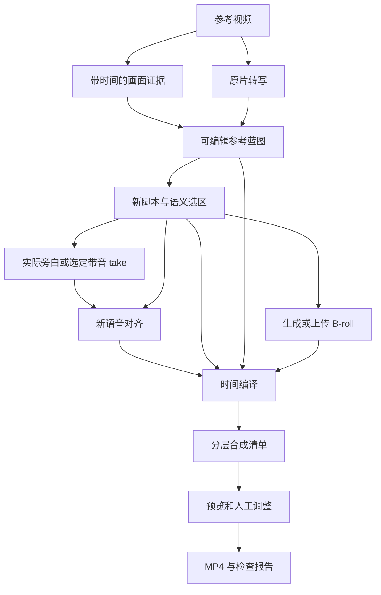

# 参考视频改编：虾画 / 虾导原生实施计划

> **For agentic workers:** REQUIRED SUB-SKILL: Use superpowers:executing-plans to implement this plan task-by-task. Steps use checkbox (`- [ ]`) syntax for tracking. 实施状态与验收缺口见 `docs/experiments/reference-video-remix-implementation-status.md`；本文的复选框仍以完整验收为准。

**Goal:** 用户上传参考视频，虾导拆解其表达结构，按新主题改写，调用现有生成能力，并依据实际旁白安排字幕、B-roll 和音效，在虾画中编辑并导出竖屏 MP4。

**Architecture:** 保留现有画布、Recipe、工作流确认和任务系统，增加项目内版本化结构产物、转写/对齐处理动作、确定性的时间编译及分层渲染。虾导负责创作决策和调度；时间、版本、权限和执行结果由后端校验。Hypit 仅作为语义标记及实际语音驱动时间线的设计参考。

**Tech Stack:** Python 3.11、FastAPI、Pydantic、现有任务 runner；React/TypeScript、现有画布和编辑器；FFmpeg/ffprobe、ASS 字幕；ASR/强制对齐使用隔离适配器，P0 实测后锁定引擎及权重版本。

## Global Constraints

- 日期：2026-09-18。基线：本次 `git fetch origin staging` 得到的 `dcfbc726774b5b0a711b21b70b37225a49d1b87b`。
- 实施分支：`codex/reference-video-remix-plan`；当前已有分阶段基础实现，完整验收仍待 P0 真实样片。
- 需求来源：2026-09-15《参考视频改编：原生虾画实施计划》。本文件整合该文档及本次代码复核，仓库内阅读无需依赖 Downloads 文件。
- MVP：15–60 秒、单说话人、9:16、中文或英文、旁白驱动；输出 1080×1920/30fps。
- 支持图片/视频 B-roll、逐词或逐字高亮字幕、基础淡入淡出和缩放、旁白/BGM/SFX 分轨；音效允许上传。
- 后续范围：跨语言变体、多说话人、口型同步、HTML 动效、人脸跟踪、批量生产、关闭页面后持续自动提交后续步骤。
- 现有浏览器协调执行边界保持：页面关闭后已提交任务可继续；重新打开先对账，再继续可执行步骤。
- 所有生成经过现有用户确认、权限、模型能力、任务信封和计费路径；模型或 Skill 文本不能绕过这些路径。
- Python 兼容 3.11；前端视觉实现先读 `DESIGN.md`，遵守现有变量与中英文文案规则。
- 新依赖通过独立环境/服务安装并锁定版本；业务请求中不安装依赖、不下载权重。
- 原片时间仅用于证据和结构分析；新成片时间以最终采用的实际语音为准。
- 内部时间使用整数微秒，输出使用整数帧；文本字符区间使用 Unicode code point 半开区间。
- 旧 Recipe、画布、合成数据保持旧语义；新协议显式标识版本，禁止静默转换后覆盖旧数据。

---

## 1. 交付结果与实施顺序

用户路径：上传参考片 → 检查参考拆解 → 输入新主题/产品 → 编辑改写台词 → 生成或上传旁白和素材 → 自动安排字幕/B-roll → 预览、调整、导出。首版保留可编辑的拆解和脚本结果；付费生成沿用现有确认机制。

拆成两个可独立验收的交付结果：

1. **可编辑成片（M1–M3）：** 使用上传旁白和固定素材，完成拆解、脚本选区、对齐、时间编译、编辑及 MP4 导出。
2. **虾导自动编排（M4–M5）：** 在上述能力上接入创作 Recipe、生成模型、混合工作流、局部重跑和刷新恢复。

P0 必须先交付真实样片。固定素材样片通过后才能锁定技术选型和全量排期；它不等于生产版完整流程通过。



## 2. 最新 staging 的代码依据

以下是本次实际读取的实现；后续执行若换基线，先重新核对这些入口。

| 已有入口 | 当前行为 | 计划中的改造 |
| --- | --- | --- |
| `src/novelvideo/freezone/jobs.py` | 合成铺平全部视频轨，重叠报错；1080p 映射为 1920×1080 | 保留旧合成入口；增加明确画幅的分层渲染服务 |
| `src/novelvideo/api/schemas.py` | 合成仅有 video/audio，秒级位置 | 新版本请求引用合成清单及精确 revision |
| `frontend/src/features/canvas/compose/timelineModel.ts` | 多轨编辑状态仍提交旧后端契约 | 新清单编辑模型及人工覆盖；旧时间线独立兼容 |
| `frontend/src/features/canvas/domain/nodeRegistry.ts` | `videoStoryNode` 无输出 handle | 作为参考蓝图入口，支持下游结构引用 |
| `src/novelvideo/freezone/jobs.py` 的抽帧 | scene 检测带帧数上限，少量切镜时均匀抽帧 | 全片扫描时间信息，按预算选代表帧，记录 PTS/time_base |
| `src/novelvideo/freezone/recipe_runtime.py` | `RecipeNodeKind` 仅 image/video/audio/text；缓存用于 Prompt 编译 | 增加显式结构输出执行及校验，单独管理产物复用 |
| `src/novelvideo/freezone/html_artifacts.py` | 已有项目隔离、不可变 HTML revision、写入锁 | 复用其设计与公共基础设施，新建结构产物存储；不强行改造 HTML 存储格式 |
| `schemas/workflow/v1/stable-contract.json` | 缺少两个新节点、故事节点及处理动作 | 从单一契约源贯通 Python/TS/MCP 和执行适配 |
| `src/novelvideo/freezone/workflow_plan.py` | 合成要求视频输入；生成节点按 Recipe/模型校验 | 增加结构输入和处理动作分支，保留现有媒体校验 |
| `src/novelvideo/api/routes/freezone.py` | `canvas_approval_bridge`，`headless_execution=false` | 沿用确认/回执/运行对账，明确页面关闭行为 |
| `tests/test_agent_canvas_revision_contract.py` | 画布写入已有版本保护回归 | 新动作接入既有保护，另加 artifact/node revision 校验 |
| `frontend/src/features/freezone/canvasNodeActionCatalog.ts` | 节点动作及模型能力目录入口 | 新处理动作由目录发现；生成继续使用实时模型目录 |

不要把日常开发分支中的实现当成 staging 已有能力；每个引用媒体的绑定路径都必须在本基线上通过测试。

## 3. 模块边界和数据契约

新增后端代码集中到 `src/novelvideo/freezone/remix/`，避免继续把编译、存储及滤镜逻辑加入 `jobs.py`。以下路径均为拟新增，现有入口标为“修改”。

| 文件 | 单一职责 |
| --- | --- |
| `src/novelvideo/freezone/remix/contracts.py` | 六种结构 schema、状态、精确引用和验证 |
| `src/novelvideo/freezone/remix/store.py` | 项目内不可变 revision、内容 hash、原子发布、CAS |
| `src/novelvideo/freezone/remix/evidence.py` | 媒体探测、全片时间证据和代表帧 |
| `src/novelvideo/freezone/remix/alignment.py` | 适配转写/对齐引擎，输出统一词/字时间协议 |
| `src/novelvideo/freezone/remix/timing.py` | 选区映射、音轨编辑映射、输出帧及覆盖冲突 |
| `src/novelvideo/freezone/remix/render.py` | 清单验证、ASS、FFmpeg 分层及音轨渲染 |
| `src/novelvideo/freezone/remix/operations.py` | 幂等操作、依赖失效、完成结果是否可回填 |
| `src/novelvideo/api/routes/remix.py` | 身份/项目授权、请求校验、提交任务、读取产物 |
| `src/novelvideo/task_backend/runners/remix.py` | 使用现有任务生命周期调用各服务并发布结果 |
| `frontend/src/api/remix.ts` | 新请求及结果类型 |
| `frontend/src/features/canvas/remix/model.ts` | 节点引用、选区和时间编辑模型 |
| `frontend/src/features/canvas/remix/selection.ts` | UTF-16 与 code point 转换、文本编辑后选区失效 |
| `frontend/src/features/canvas/remix/RemixEditor.tsx` | 转写、选区、事件及精确预览入口 |

六种逻辑 schema 共用一个存储 envelope，不建立六套独立存储系统：

| schema | 必须保存的内容 |
| --- | --- |
| `reference_evidence.v1` | 媒体 hash、原始 PTS/time_base、时长、切镜、代表帧及转写引用 |
| `word_timeline.v1` | 媒体及脚本版本、语言、词/字跨度、起止微秒、匹配状态、置信度或明确无置信度 |
| `reference_blueprint.v1` | 叙事作用、事件、证据引用、保留/替换规则；区分观察、推断和用户选择 |
| `remix_script.v1` | 台词、segment ID、selection ID、字符区间、蓝图映射、素材需求 |
| `performance_timing.v1` | 选区至实际音轨及输出帧的映射、未解析事件、覆盖冲突 |
| `composition_manifest.v1` | 输出规格、媒体精确绑定、图层/字幕/音频事件、人工覆盖及来源版本 |

Envelope 字段：`id, schema, revision, project_id, created_by, content_hash, upstream_refs, producer_version, payload_path`。项目授权以项目成员权限为准，不能仅按创建者过滤。节点保存 `{artifact_id, revision}` 和小摘要，大数组放入项目产物文件。

接口错误约定：无权限按现有项目策略处理；资源缺失 404；revision 冲突 409；输入/必需事件不完整 422；引擎未就绪 503。任务结果使用 `completed / needs_review / failed / cancelled` 业务状态，映射到现有任务状态；无语音和脚本不匹配不能伪装成有效时间线。

### 时间计算约定

`selection_id` 保留语义身份；脚本 revision 与字符跨度确定本次位置。编辑后映射不确定时标记失效，不能选取“第一个同名词”。中文不依赖空格。

给定源音轨区间 `[source_start_us, source_end_us)`、成片起点 `timeline_start_us` 和正数变速 `speed`：

```text
output_us = timeline_start_us + (source_us - source_start_us) / speed
start_frame = floor(start_us * fps / 1_000_000)
end_frame   = ceil(end_us * fps / 1_000_000)     # 半开区间
```

编译以整数/有理数运算避免连续浮点累计；变速比例以正整数分子/分母持久化。跨剪切点的事件按时间映射段拆分；被删除的必需语义阻塞，出界策略显式选择阻塞/裁剪/省略，可选事件省略需要保存用户选择。视频和语音应用相同编辑映射。

人工修改保存独立覆盖：相对语义的偏移随旁白重新计算；固定帧覆盖在重新编译后显示冲突并要求处理。禁止静默抹掉手工调整。

### 预览约定

同一 manifest 不自动保证浏览器与 FFmpeg 的字形和排版一致。首版提供后端同渲染器生成的精确预览，可另有标明“编辑预览”的即时草图；预览标注所用 revision，编辑后旧预览显示过期。精确预览和导出使用同一字体、布局、fps 和事件边界。

## 4. P0：技术验证（原估 3–5 人日，完成后重估）

### Task 1：真实音频、叠层样片和契约验证

**新增：** `scripts/experiments/reference_video_remix_p0.py`、`tests/fixtures/remix/README.md`、`tests/fixtures/remix/cases.json`、`docs/experiments/reference-video-remix-p0.md`。

**输入/输出：** 固定参考片、实际旁白两版、图片/视频素材及人工标注 → 转写/对齐 JSON、试验 manifest、MP4、性能和误差报告。大型媒体与模型权重放测试资产存储，仓库只记录来源、hash 和取回方式；不提交生成媒体。

- [ ] 准备中文、英文、重复词/数字/emoji、无语音、漏词/增词、可变帧率加裁剪变速六类夹具；清晰中文和英文分别标注至少 100 个边界，记录标注方法。
- [ ] 通过独立适配器试验 WhisperX 候选方案；记录安装锁文件、模型/权重版本、CPU/GPU 类型、内存和冷/热运行耗时。候选失败则记录原因并重估，不能悄悄换成未验证的引擎。
- [ ] 先用固定字幕时间和素材验证 FFmpeg 字幕、图片叠层、视频叠层、旁白连续及 1080×1920/30fps 输出，再接入真实对齐结果。
- [ ] 将同一脚本的两版不同语速音频分别对齐，验证“商品登场”事件随着对应词移动，而非保持原片秒数。
- [ ] 跑最小结构 Recipe 结果校验和处理动作绑定试验，分别记录当前校验链拒绝点；据此确认 Task 8 的协议版本方案。
- [ ] 报告 JSON 保存 `case_id, engine_version, device, duration_s, elapsed_s, peak_memory_mb, boundary_p95_ms, unresolved_required_events, output_probe, status`；区分实测数值和目标。

拟新增试验命令（脚本实现后使用）：

```bash
uv run python scripts/experiments/reference_video_remix_p0.py --cases tests/fixtures/remix/cases.json --asset-root /tmp/remix-fixtures --output-dir /tmp/remix-p0
ffprobe -v error -show_entries stream=codec_type,width,height,r_frame_rate -of json /tmp/remix-p0/zh-clear/output.mp4
```

**通过条件：** 六类输入有明确结果；清晰语音两种语言各自 P95 ≤200ms 或明确缩小支持范围；两版语速生成可播放样片；必要事件全部定位或阻塞；证明目标机器可承担单任务。资源限额和并发值写入试验报告后再实施生产调度。

**提交建议：** `docs(remix): record alignment and layered rendering feasibility`。P0 未达门槛时继续解决试验问题，不启动全量节点建设。

## 5. M1：结构产物与参考拆解（原估 6–8 人日）

### Task 2：版本化结构产物和 API

**新增：** `src/novelvideo/freezone/remix/__init__.py`、`contracts.py`、`store.py`、`src/novelvideo/api/routes/remix.py`、`tests/test_remix_artifacts.py`、`tests/test_api_remix_artifacts.py`。
**修改：** `src/novelvideo/api/__init__.py`。

**接口：** `RemixArtifactStore(project_dir: Path, project_id: str)` 提供 `create(schema: str, payload: dict, upstream_refs: list[dict]) -> dict`、`read(artifact_id: str, revision: int) -> dict`、`revise(artifact_id: str, expected_revision: int, payload: dict, upstream_refs: list[dict]) -> dict`。创建者取认证上下文；这些接口在实现时用 Task 2 的 Pydantic 模型替代裸字典。

- [ ] 先测试 schema 不合法不落盘、同版本并发修改仅一个成功、跨项目引用拒绝、文件消失不命中缓存、不可变历史可读取。
- [ ] 按 `freezone/_remix_artifacts/<id>/<revision>.json` 保存版本，项目写入锁内检查 revision；先写临时文件、校验，再原子发布。复用现有项目路径/写锁接口。
- [ ] 路由前缀 `/projects/{project}/freezone/remix`：`POST /artifacts`、`GET /artifacts/{id}?revision=N`、`PUT /artifacts/{id}`；更新必须带 `expected_revision`。读 viewer、写 editor，并按现有项目归属与 home-node 规则解析路径。
- [ ] 节点更新引用时同时检查画布/node revision 与 artifact revision；历史保存成功但当前节点已变更时只保留历史并返回 stale 状态。
- [ ] 执行 `uv run pytest tests/test_remix_artifacts.py tests/test_api_remix_artifacts.py`，通过后提交 `feat(remix): persist versioned structured artifacts`。

### Task 3：全片证据、转写和原生节点

**新增：** `src/novelvideo/freezone/remix/evidence.py`、`alignment.py`、`src/novelvideo/task_backend/runners/remix.py`、`frontend/src/api/remix.ts`、`frontend/src/features/canvas/nodes/TranscriptNode.tsx`、`tests/test_remix_evidence.py`、`tests/test_remix_alignment.py`、`tests/test_remix_tasks.py`。
**修改：** `src/novelvideo/task_backend/runners/freezone.py`（加载 runner 注册）、`src/novelvideo/api/routes/remix.py`、`frontend/src/features/canvas/domain/canvasNodes.ts`、`nodeRegistry.ts`、`frontend/src/features/canvas/nodes/index.ts`、`VideoStoryNode.tsx`、`frontend/src/features/canvas/application/videoAnalyzeStory.ts`。

**接口：** `build_reference_evidence(media_path: Path) -> dict`；`transcribe_media(media_path: Path, language: str) -> dict`；`align_script(media_path: Path, script: dict) -> dict`。输出分别遵守 evidence/word_timeline schema，媒体路径由服务端项目解析器提供。

- [ ] 先测试全片尾段有证据、PTS 换算、VFR、无语音、脚本漏词/增词；外部引擎单测使用适配器替身，真实夹具仍运行 P0 测试。
- [ ] 全片检测切镜并保存时间信息，再按预算取代表帧；把原片转写与视觉证据交给蓝图分析，每个判断保存引用及观察/推断标记。
- [ ] 注册 `transcribe_media`、`align_script` 处理入口并以现有任务信封提交。资源队列、超时、取消、任务位置采用 P0 实测结果和现有 registry；需要本地素材时不得直接声明可任意节点执行。
- [ ] 新转写节点显示文字、时间、匹配问题，支持定位播放、校字、重新对齐及 JSON/SRT 导出。不改变发音的文字修订保留时间并标记人工修订；变化影响跨度时重对齐。
- [ ] 视频故事节点显示可编辑参考蓝图，开启输出端口；前端手动路径先调用上述服务，Agent/Workflow 统一接线在 Task 8 完成。
- [ ] 执行 `uv run pytest tests/test_remix_evidence.py tests/test_remix_alignment.py tests/test_remix_tasks.py`；补充并运行 `frontend/src/features/canvas/remix/TranscriptNode.test.tsx`，通过后提交 `feat(remix): expose reference evidence and speech alignment`。

## 6. M2：脚本选区与实际时钟（原估 5–8 人日）

### Task 4：选区编辑、版本失效和语义时间编译

**新增：** `src/novelvideo/freezone/remix/timing.py`、`frontend/src/features/canvas/remix/model.ts`、`selection.ts`、`selection.test.ts`、`RemixEditor.tsx`、`frontend/src/features/canvas/nodes/SemanticTimelineNode.tsx`、`tests/test_remix_timing.py`。
**修改：** `frontend/src/features/canvas/nodes/ScriptNode.tsx`、`frontend/src/features/canvas/domain/canvasNodes.ts`、`nodeRegistry.ts`、`frontend/src/features/canvas/nodes/index.ts`、`src/novelvideo/api/routes/remix.py`。

**接口：** `compile_timing(script: dict, words: dict, edit_map: list[dict], overrides: list[dict], fps: int) -> dict`，返回 performance_timing schema。`selection_id + script_revision` 与词/字字符跨度匹配；媒体 hash 或 revision 不一致立即拒绝。

- [ ] 先写重复词、emoji、增删台词、错媒体版本、裁剪/变速、跨剪切点、短事件最小时长、越界及固定时间覆盖冲突测试。
- [ ] 选区保存稳定 ID、字符跨度和本次脚本 revision；无法保留的选区标记 invalid 并显示原因，禁止通过字符串首次匹配恢复。
- [ ] 后端按第 3 节公式编译音轨局部时间和输出帧；结果保存输入精确版本、未解析必需事件和人工覆盖冲突。
- [ ] 编辑器支持命名选区、预览实际声音、调整相对偏移/显示时长，以及显式固定帧覆盖；新语义时间轴节点显示这些事件和阻塞原因。
- [ ] 执行 `uv run pytest tests/test_remix_timing.py` 和 `pnpm -C frontend test src/features/canvas/remix/selection.test.ts`，通过后提交 `feat(remix): compile semantic selections against actual speech`。

用于首个时间算例的测试内容（`timing.py` 同时提供该纯函数）：

```python
from novelvideo.freezone.remix.timing import map_source_interval_to_frames

def test_trimmed_double_speed_interval():
    assert map_source_interval_to_frames(
        start_us=2_000_000, end_us=3_000_000,
        source_start_us=1_000_000, timeline_start_us=3_000_000,
        speed_num=2, speed_den=1, fps=30,
    ) == (105, 120)
```

## 7. M3：分层渲染及可编辑成片（原估 7–10 人日）

### Task 5：合成清单、字幕与分层后端

**新增：** `src/novelvideo/freezone/remix/render.py`、`tests/test_remix_render.py`、`tests/test_remix_render_integration.py`。
**修改：** `src/novelvideo/api/routes/remix.py`、`src/novelvideo/task_backend/runners/remix.py`、`src/novelvideo/freezone/remix/contracts.py`。

**接口：** `build_manifest(timing: dict, media_bindings: dict, style: dict) -> dict` 把 performance_timing 和实际素材规格组装为 composition_manifest；`validate_manifest(manifest: dict) -> dict` 校验该清单；`render_manifest(manifest: dict, media_paths: dict[str, Path], output_path: Path) -> Path` 执行渲染。媒体表 key 为 manifest 内 media ID，路径由授权解析器给出；渲染器不自行下载任意 URL。

- [ ] 先测试图片和视频重叠、z-order、透明度、裁剪、字幕换行、中文字体、逐词高亮、静音素材、旁白与 BGM/SFX 混音、越界事件。
- [ ] manifest 固定宽高/fps/duration_frames；事件带 `start_frame/end_frame`、媒体精确引用、位置/尺寸/fit、z-order 和类型对应参数；拒绝不支持的效果。
- [ ] 素材需求 ID 显式绑定实际媒体，检查媒体时长和尺寸；图片可延长显示，视频不足时由保存的策略决定裁剪事件、定格尾帧或阻塞，禁止默认循环来掩盖不足。
- [ ] FFmpeg 在明确颜色背景上依次 overlay，字幕生成 ASS；字幕总时长、字词高亮的百分之一秒量化误差纳入检查。旁白独立混音，不因画面覆盖中断。
- [ ] 变速/裁剪共享编译后的映射；实现基础淡入淡出、缩放及确定性 BGM 音量包络，帧率、字体和编码配置固定并记录。
- [ ] 使用参数数组启动子进程；转义字幕及滤镜文本；输出临时文件通过 ffprobe 后原子发布。取消终止进程并清理半成品。
- [ ] 新渲染使用 `/projects/{project}/freezone/remix/render`，请求 `{manifest_ref, idempotency_key, node_revision}`，返回现有可查询任务引用；旧合成接口继续走旧渲染器。
- [ ] 执行 `uv run pytest tests/test_remix_render.py tests/test_remix_render_integration.py tests/test_freezone_video_compose_history.py`，真实集成测试检查像素和音频，而非只检查文件存在；通过后提交 `feat(remix): render layered portrait compositions`。

### Task 6：清单编辑、精确预览及手动更新

**新增：** `frontend/src/features/canvas/remix/manifestEditor.ts`、`manifestEditor.test.ts`、`RemixEditor.test.tsx`。
**修改：** `frontend/src/features/canvas/remix/RemixEditor.tsx`、`frontend/src/features/canvas/nodes/VideoComposeNode.tsx`、`frontend/src/features/canvas/compose/VideoComposeModal.tsx`、`frontend/src/api/remix.ts`、`frontend/public/locales/zh/translation.json`、`frontend/public/locales/en/translation.json`。

**接口：** 编辑器读取 manifest 引用及覆盖层，保存生成新 revision；preview/render 均绑定该 revision，下载卡片显示对应版本。

- [ ] 先测试旧时间线正常打开、新 manifest 路由正确、编辑导致预览过期、旧渲染完成不覆盖新版本、手动偏移重算保留。
- [ ] 合成节点按数据中的显式 schema 进入旧编辑器或 remix 编辑器；新编辑器支持替换素材、调字幕样式、调整位置和时间、发起精确预览与导出。
- [ ] 无必需素材、未解析事件或冲突时显示具体修复入口并禁用最终导出；允许保存草稿。
- [ ] 执行 `pnpm -C frontend test src/features/canvas/remix`；完成浏览器验收：上传固定素材、修改、保存、刷新、重新打开、导出并播放。
- [ ] 提交 `feat(remix): edit and preview versioned compositions`，验收“可编辑成片”交付点。

## 8. M4：虾导编排、局部重跑和恢复（原估 6–9 人日）

### Task 7：创作 Recipe 和结构结果交付

**新增：** `src/novelvideo/freezone/agent_catalog/builtins/recipes/reference-blueprint.json`、`reference-remix-script.json`、`reference-broll-plan.json`、`tests/test_remix_recipe_contract.py`。
**修改：** `src/novelvideo/freezone/agent_catalog_schema.py`、`recipe_runtime.py`、`src/novelvideo/freezone/agent_config_store.py`、`frontend/src/api/ops.ts`、`frontend/src/lib/recipe-output.ts`、`frontend/src/features/canvas/application/workflowRecipeRuntime.ts`。

**接口：** Recipe v2 增加 `input_contract`、`output_schema`；结构输出属于明确的新类型，走 JSON 校验及 artifact 发布。保留 v1 解析/执行分支，HTML 文本输出回归必须通过。该决策由 P0 最小导入与执行试验验证后落实。

- [ ] 先测试 v1 往返保持行为、v2 字段保存/导入不丢失、JSON 不合法不发布、schema 不匹配不完成交付，以及当前目录搜索/摘要能发现新 Recipe。
- [ ] 创作结果先解码、验证引用和必需字段，再发布版本；无效结果最多进行一次有界修复，仍失败返回明确问题，不能用自然语言摘要代替结构结果。
- [ ] 分析 Recipe 引用证据；改写 Recipe 输出新字符跨度与语义映射；B-roll Recipe 输出素材需求。生成图/视频/音频继续使用现有能力目录及真实模型参数。
- [ ] 记录结构输出成本和可信调用凭证，接入 `src/novelvideo/freezone/agent_product_operations.py` 的交付路径；Prompt 缓存命中不代表媒体已存在。
- [ ] 执行 `uv run pytest tests/test_remix_recipe_contract.py tests/test_recipe_runtime.py tests/test_agent_catalog_search.py`，通过后提交 `feat(remix): publish validated creative recipe artifacts`。

### Task 8：公共契约、处理步骤、虾导调用和输入绑定

**修改：** `schemas/workflow/v1/stable-contract.json`、`scripts/generate_workflow_contract.py`、`src/novelvideo/freezone/workflow_schema.py`、`workflow_semantics.py`、`workflow_plan.py`、`workflow_preflight.py`、`workflow_runs.py`、`workflow_transactions.py`、`frontend/src/features/freezone/canvasNodeActionCatalog.ts`、`canvasChatCommands.ts`、`context/canvasCommandValidator.ts`、`.hermes/plugins/freezone/__init__.py`、`src/novelvideo/chat/workflow_mcp.py`。
**新增：** `frontend/src/features/canvas/application/workflowRemixRuntime.ts`、`workflowRemixRuntime.test.ts`、`tests/test_remix_workflow.py`。
**生成物：** `src/novelvideo/freezone/workflow_contract_generated.py`、`frontend/src/features/freezone/generated/workflowContract.ts`、`src/novelvideo/chat/workflow_contract.generated.json`。

**接口：** 新版 step 用 `step_kind=generate|process` 区分；process 使用服务端动作注册表，接受类型化 artifact/media 引用，不要求 Recipe ID。动作包含 `transcribe_media`、`align_script`、`compile_semantic_timeline` 和 manifest 渲染。旧计划走兼容解析分支。

- [ ] 先测试两个新节点和故事节点可创建并合法连线、处理步骤缺失/伪造动作被拒绝、生成仍要求正确 Recipe/模型、上传媒体可精确绑定到该流程。
- [ ] 公共源增加 process 动作及版本能力；generator 同步生成各端。接口能力明确新旧计划支持范围，旧客户端不接收无法执行的新计划。
- [ ] 输入端口声明 `reference_media / narration / script / aligned_words / blueprint / visual_asset / composition`；优先沿用 `dependency_for` 与现有媒体连线，只有 P0 证明表达不足时增加 link type。
- [ ] 改造合成输入校验，支持图片+旁白和 manifest 输入；保留旧 `videoComposeNode` 请求至少有视频的原有规则。
- [ ] 处理任务通过现有权限、确认、信封和取消路径；Agent 动作发现接入最新目录，禁止在 Skill 中硬编码过期模型别名。
- [ ] 更新 `src/novelvideo/agent_skills/dramaclaw-workflows/SKILL.md`、`agent-kit/skills/dramaclaw-workflows/SKILL.md` 及其对应 `references/workflow-operations.md`，写入分阶段创作、缺素材暂停、校验失败修复和实际完成凭证规则。
- [ ] 执行 `uv run python scripts/generate_workflow_contract.py` 后再执行 `uv run python scripts/generate_workflow_contract.py --check`；运行 `uv run pytest tests/test_remix_workflow.py tests/test_workflow_stable_contract.py tests/test_workflow_plan.py tests/test_workflow_semantics.py tests/test_agent_canvas_revision_contract.py` 和新增前端 runtime 测试。
- [ ] 提交 `feat(remix): orchestrate typed processing and generation steps`。

### Task 9：精确失效、幂等和页面恢复

**新增：** `src/novelvideo/freezone/remix/operations.py`、`tests/test_remix_operations.py`、`tests/test_remix_recovery.py`。
**修改：** `src/novelvideo/freezone/workflow_runs.py`、`workflow_observation.py`、`src/novelvideo/task_backend/runners/remix.py`、`frontend/src/features/freezone/WorkflowRunRecoveryBar.tsx`、`frontend/src/features/canvas/application/workflowRemixRuntime.ts`。

**接口：** operation 记录 `operation_id, input_refs, producer_version, normalized_parameters, task_id, provider_task_id, status, output_refs`；复用键包含项目、输入内容 hash/版本、执行器版本及输出规格。

- [ ] 先测试同幂等键重试仅提交一次、主动 regenerate 创建新操作、provider 超时先查询、worker 中断与用户取消、旧结果迟到不覆盖、输出文件被删不能假复用。
- [ ] 同 operation 持久化绑定现有任务；付费调用结果不确定时标记待对账，不发新调用补救。不支持外部任务查询的 provider 返回需人工处理状态。
- [ ] 按下表传播失效；下游引用精确 revision。素材仍有效时直接复用，不能只比较 Prompt。
- [ ] 页面重开先查询已提交任务与 artifact，完成回填后才申请继续；关闭页面时不承诺后台自行发起下一步。
- [ ] 执行 `uv run pytest tests/test_remix_operations.py tests/test_remix_recovery.py tests/test_workflow_observation.py tests/test_api_freezone_workflow_runs.py`；测试中断言具体付费接口调用次数；通过后提交 `feat(remix): resume operations and invalidate exact dependents`。

| 修改 | 重新计算/执行 | 必须复用 |
| --- | --- | --- |
| 字幕颜色 | 字幕呈现、合成 | 转写、旁白、B-roll |
| 一个 B-roll 提示词 | 该素材、尺寸/时长检查、合成 | 旁白、对齐、无关素材 |
| 台词并生成新旁白 | 旁白、对齐、相关素材、时间编译、合成 | 无依赖的素材 |
| 替换实际采用的 take | 对齐、时间编译、合成 | 无依赖的其他素材 |
| Recipe/动作版本变化 | 使用该版本的步骤及真实下游 | 其他步骤 |

## 9. M5：发布验证与交付（原估 3–5 人日）

### Task 10：兼容、部署及真实用户路径验收

**新增：** `tests/test_remix_acceptance.py`、`docs/features/reference-video-remix.md`。
**修改：** P0 选定引擎对应的部署/依赖配置、`docs/freezone-workflow-validation-boundary.md`；具体部署文件以 P0 确定的独立环境为准，不把模型依赖直接加入通用 API 镜像。

- [ ] 建立引擎启动预检和能力返回：未安装/权重未就绪时不接受对齐任务；CPU/GPU 路径与队列限额公开，任务超时和取消可观察。
- [ ] 运行以下验收矩阵；真实模型/FFmpeg 项不能以 mock 测试通过替代。
- [ ] 小规模真实生成走完整流程，保存受控样片、参数、费用、耗时及失败原因；生成质量另做人工验收。
- [ ] 兼容回归通过后运行 `uv run pytest`、`pnpm -C frontend test`、`pnpm -C frontend build`；配置/部署修改执行 `pre-commit run --all-files`。有新增视觉变量时运行 `npx @google/design.md lint DESIGN.md`。
- [ ] 文档说明支持范围、素材准备、转写校字、选区修复、局部更新及页面关闭行为；发布记录列出真实测试结果和仍需人工处理的情况。
- [ ] 提交 `docs(remix): document verified workflow and release boundaries`。

| 验收项 | 明确通过条件 |
| --- | --- |
| 对齐 | 清晰中英文分别至少 100 个人工标注边界；分别报告 P95，目标 ≤200ms；噪声及异常样本单独报告 |
| 时间编译 | 固定输入输出相同；裁剪/变速/拼接误差 ≤1 输出帧；重复词不会错绑 |
| 必要事件 | 必要事件全部解析，或阻塞并说明修复位置；允许省略的事件有用户选择记录 |
| 渲染 | 1080×1920/30fps，中文无缺字、字幕安全区正确；B-roll 叠加时旁白不中断 |
| 预览 | 同 revision 精确预览与导出指定帧和音频采样一致；编辑后旧预览显示过期 |
| 局部更新 | 改字幕或单个 B-roll 后，没有无关付费调用；有效人工覆盖保留 |
| 恢复 | 刷新、取消、旧任务迟到、worker 中断、重复提交不丢版本且不重复提交同一次付费操作 |
| 兼容 | 旧 Recipe、HTML 输出、Canvas 和 Compose 夹具保持原行为；生成契约校验通过 |
| 权限与资源 | 跨项目越权拒绝；共享项目合法成员可访问；资源删除不假命中；超限拒绝且错误可理解 |
| 创作质量 | 至少 10 个目标类型样片，逐个检查参考结构保留、改写事实、画面与台词相关性、字幕可读性；记录需人工修改数量，不用技术通过率代替内容质量 |

## 10. 排期与进入条件

原计划 P0–M5 合计 30–45 人日，假设一名熟悉代码的工程师、已有可用素材和模型凭证。该区间作为估算记录；P0 后按实测重新填写排期。M3 的预览/渲染一致性、M4 的契约贯通与恢复是主要工期风险。

| 阶段 | 可检查交付 | 进入下一阶段条件 |
| --- | --- | --- |
| P0 | 两种语速真实样片、引擎与资源报告、绑定/结构输出小样 | 对齐及渲染门槛通过，选型和生产资源预算确定 |
| M1 | 转写和蓝图可保存、编辑、重载 | 下游能读取精确版本，异常状态可区分 |
| M2 | 语义事件随实际语音重排 | 文本编辑、重复词、裁剪变速、人工覆盖测试通过 |
| M3 | 固定素材可编辑并导出 | 达成首个可用成片交付点 |
| M4 | 虾导调用完整流程且可局部更新 | 实际生成调用、付费幂等及页面恢复验证通过 |
| M5 | 支持范围内可发布版本 | 验收矩阵和旧功能回归通过 |

P0 资源预算不通过时，调整引擎/部署或缩小支持范围，并修改本文；不通过降低验收标准把失败记作完成。完全后台调度、跨语言和 HTML 动效分别立后续计划。

## 11. 本次计划交付核对

- [x] 从远端最新 staging 新建分支，记录精确基线。
- [x] 对照最新合成器、Recipe 类型、稳定契约、画布版本保护及工作流执行边界。
- [x] 保留原计划范围，补充两个交付点、精确预览策略和内容质量验收。
- [x] 明确模块文件、协议、任务依赖、回归命令和阶段门槛。
- [ ] P0 实测、功能实现及测试执行：留待实施阶段，本文不声称已经完成。
